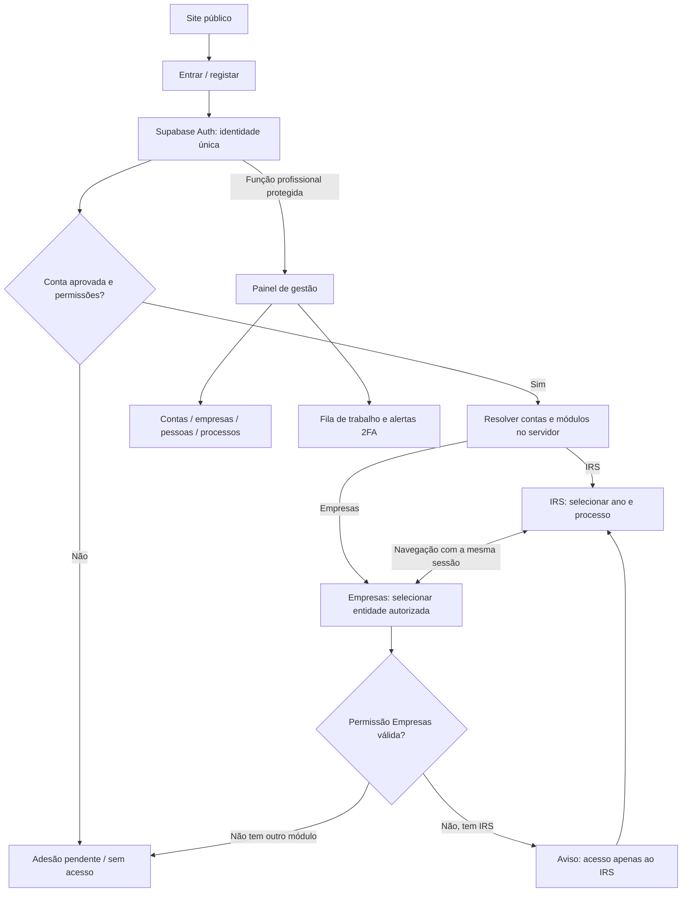

# Arquitetura e navegação

## Uma identidade, vários acessos

A pessoa autentica-se uma vez com Supabase Auth. O registo cria um utilizador e um pedido de adesão; a verificação do email não atribui acesso automático a clientes existentes ou empresas. O profissional associa ou aprova a conta-cliente e os módulos contratados. Os convites aceites permitem ligar novos utilizadores a essa conta, com permissões explícitas.

«Cliente» é a relação comercial; «utilizador» é quem inicia sessão; «pessoa do agregado» é quem integra uma declaração. Não são a mesma entidade. Um utilizador pode ter acesso a mais de uma conta-cliente, e cada conta pode ter várias empresas e vários processos anuais de IRS. Um NIF nunca concede acesso por si só.

Os botões IRS e Empresas estão sempre visíveis na área autenticada. A tentativa de entrar num módulo sem acesso produz o aviso pedido; o redirecionamento usa substituição do histórico para não criar um ciclo no botão Voltar. A API e as políticas de dados validam a permissão mesmo que alguém altere o URL ou chame diretamente o Supabase. Se perder todos os acessos, termina na página «Sem acesso», sem circular entre módulos.

Para XYZ: uma conta-cliente, o utilizador titular, três relações com empresas autorizadas e um acesso IRS. O seletor mostra apenas essas três empresas e os processos fiscais permitidos. O mesmo login e a mesma sessão servem ambos os módulos.

## Componentes propostos para implementação

- Aplicação de clientes e gestão: React + TypeScript, rotas e formulários partilhados. O site institucional estático pode continuar separado no mesmo repositório.
- Supabase Auth: autenticação, confirmação de email, recuperação e convites. MFA da nossa plataforma é distinto de 2FA do Portal das Finanças.
- PostgreSQL: contas, papéis, processos, dados fiscais, mensagens, faturação e auditoria. Row Level Security em todas as tabelas expostas.
- Supabase Storage: buckets privados; URLs assinados de curta duração depois de validar autorização.
- Edge Functions ou backend: emissão/aceitação de convites, atribuição de acessos, download autorizado, alertas, processamento de webhooks e operações privilegiadas.
- Realtime, quando necessário: mensagens e progresso, subscritos com autorização. Sem tópicos públicos com dados de clientes.
- Credenciais de serviços externos: só integrar após validar necessidade e solução de cofre. Nunca em perfis, comentários, anexos, emails ou `localStorage`.

## Rotas de aplicação previstas

| Rota | Finalidade |
|---|---|
| `/entrar/` e `/registar/` | Login e criação da identidade |
| `/convites/aceitar/` | Aceitação segura, após login na identidade convidada |
| `/app/` | Seleção de conta e módulo permitido |
| `/app/irs/:processo/` | Resumo anual |
| `/app/irs/:processo/agregado/` | Pessoas e convites |
| `/app/irs/:processo/rendimentos/` | Classes, registos e documentos |
| `/app/irs/:processo/documentos/` | Checklist e ficheiros |
| `/app/irs/:processo/mensagens/` | Conversa com o profissional |
| `/app/irs/:processo/progresso/` | Estado, pedidos e entregas |
| `/app/faturacao/` | Faturas e pagamentos da conta permitida |
| `/app/empresas/` | Futuro seletor de empresas |
| `/gestao/` | Fila de trabalho e alertas |
| `/gestao/clientes/:conta/` | Gestão de acessos e processos |

## Implementação por fases

1. Rever este protótipo e o dicionário de dados; confirmar as regras de representação do agregado e desenhar o cofre para as senhas do Portal das Finanças, cuja necessidade já foi confirmada.
2. Ligar Supabase de desenvolvimento. Criar esquema, políticas, funções e testes de isolamento, antes de dados reais.
3. Registo, convite, aprovação, recuperação e navegação entre módulos.
4. Agregado e IRS anual; rendimentos, imóveis, checklist e upload privado.
5. Comunicação, progresso, entregas e alertas no painel profissional.
6. Consulta de faturas e pagamentos, inicialmente com registo manual e documentos. Integração de pagamento só numa fase posterior.
7. Plataforma Empresas: utilizar a mesma identidade, conta-cliente e permissões.

Ainda não são necessários segredos Supabase para rever os desenhos. Não enviar chaves privadas em chat. A URL e a chave publicável serão configuração da aplicação; segredos privilegiados ficarão exclusivamente no servidor.
