# Dados, relações e acesso

Modelo lógico para posterior implementação em PostgreSQL/Supabase. Não é uma migração executada. Os campos de auditoria (`id`, `created_at`, `updated_at`, autores) estão implícitos nas entidades abaixo, salvo indicação contrária.

## Relações

```mermaid
erDiagram
  AUTH_USERS ||--|| PROFILES : tem
  AUTH_USERS ||--o{ STAFF_ASSIGNMENTS : profissional
  CLIENT_ACCOUNTS ||--o{ STAFF_ASSIGNMENTS : atribui
  AUTH_USERS ||--o{ ACCOUNT_MEMBERS : pertence
  CLIENT_ACCOUNTS ||--o{ ACCOUNT_MEMBERS : autoriza
  CLIENT_ACCOUNTS ||--o{ MODULE_GRANTS : contrata
  CLIENT_ACCOUNTS ||--o{ ACCOUNT_COMPANIES : relaciona
  COMPANIES ||--o{ ACCOUNT_COMPANIES : integra
  ACCOUNT_MEMBERS ||--o{ COMPANY_GRANTS : limita
  ACCOUNT_COMPANIES ||--o{ COMPANY_GRANTS : permite
  CLIENT_ACCOUNTS ||--o{ PERSONS : inclui
  AUTH_USERS o|--o{ PERSONS : identidade_opcional
  CLIENT_ACCOUNTS ||--o{ INVITATIONS : emite
  PERSONS o|--o{ INVITATIONS : destina
  CLIENT_ACCOUNTS ||--o{ IRS_CASES : possui
  IRS_CASES ||--o{ CASE_PERSONS : agregado_anual
  PERSONS ||--o{ CASE_PERSONS : identifica
  AUTH_USERS ||--o{ CASE_PERSON_ACCESS : colabora
  CASE_PERSONS ||--o{ CASE_PERSON_ACCESS : restringe
  CASE_PERSONS ||--o| PORTAL_ACCESS_STATUS : declara
  CASE_PERSONS ||--o{ REPRESENTATION_CONSENTS : autoriza
  PERSONS ||--o{ EXTERNAL_CREDENTIAL_REFERENCES : referencia_cofre
  IRS_CASES ||--o{ INCOME_GROUPS : adiciona
  INCOME_GROUPS ||--o{ INCOME_RECORDS : contem
  CASE_PERSONS o|--o{ INCOME_RECORDS : titular_pessoal
  IRS_CASES ||--o{ PROPERTY_ASSETS : contem
  PROPERTY_ASSETS o|--o{ INCOME_RECORDS : imovel
  PROPERTY_ASSETS ||--o{ PROPERTY_OWNERS : afeta
  CASE_PERSONS ||--o{ PROPERTY_OWNERS : participa
  IRS_CASES ||--o{ DEDUCTIONS : despesas_beneficios
  CASE_PERSONS o|--o{ DEDUCTIONS : beneficia
  IRS_CASES ||--o{ DOCUMENT_REQUIREMENTS : checklist
  IRS_CASES ||--o{ DOCUMENTS : arquivos
  DOCUMENTS ||--o{ DOCUMENT_VERSIONS : historico
  DOCUMENT_REQUIREMENTS ||--o{ REQUIREMENT_FILES : aceita
  DOCUMENT_VERSIONS ||--o{ REQUIREMENT_FILES : comprova
  INCOME_RECORDS o|--o{ DOCUMENT_REQUIREMENTS : exige
  CASE_PERSONS o|--o{ DOCUMENT_REQUIREMENTS : identifica
  PROPERTY_ASSETS o|--o{ DOCUMENT_REQUIREMENTS : identifica
  IRS_CASES ||--o{ CONVERSATIONS : comunica
  CONVERSATIONS ||--o{ MESSAGES : contem
  MESSAGES ||--o{ MESSAGE_ATTACHMENTS : anexa
  DOCUMENT_VERSIONS ||--o{ MESSAGE_ATTACHMENTS : referencia
  IRS_CASES ||--o{ PROGRESS_EVENTS : regista
  IRS_CASES ||--o{ TASKS_ALERTS : acompanha
  IRS_CASES ||--o{ INTERNAL_NOTES : reserva
  CLIENT_ACCOUNTS ||--o{ INVOICES : recebe
  INVOICES ||--o{ PAYMENTS : concilia
  CLIENT_ACCOUNTS ||--o{ AUDIT_EVENTS : audita
```

## Identidade e permissões

| Entidade | Campos e regras principais |
|---|---|
| `auth.users` | Email de login e palavra-passe tratados exclusivamente por Supabase Auth; não duplicar hashes ou passwords. |
| `profiles` | `user_id`, nome, telemóvel, idioma. O papel de profissional não pode ser escolhido pelo utilizador nem obtido de metadados editáveis. |
| `staff_assignments` | Utilizador profissional, conta atribuída, função e estado. Só administração autorizada pode gerir estes vínculos. |
| `client_accounts` | Nome da conta, titular/relação comercial, morada postal estruturada, estado `pending/active/suspended/closed`. Não é uma empresa nem um processo IRS. |
| `account_members` | `account_id`, `user_id`, papel `owner/member`, estado; unicidade conta/utilizador. Escopo explícito para o agregado; pertença não concede automaticamente leitura de todas as pessoas. |
| `module_grants` | Conta, módulo `irs/business`, estado e período de validade; unicidade de concessão ativa por conta/módulo. A concessão é administrada pelo profissional. |
| `companies` | Nome legal, NIF de entidade, estado. Entidade reutilizável sem duplicação de dados da mesma empresa. |
| `account_companies` | Relação conta/empresa e estado; uma conta XYZ liga três empresas. |
| `company_grants` | Membro da conta e relação conta/empresa; granularidade por empresa. Um módulo ativo não dá acesso a empresas de outras contas. |
| `invitations` | Conta, pessoa opcional, email normalizado, escopo proposto, validade, estado, autor, token apenas com hash; unicidade de convite pendente aplicável. Aceitar exige email autenticado correspondente, token válido e consumo atómico. |

Uma pessoa do agregado não é obrigada a ter login. O email é opcional até haver convite. Quando aceita um convite, o `user_id` é ligado à pessoa correta mediante autorização, nunca através de pesquisa pública por NIF. O convite não dá acesso aos dados do cônjuge ou de outros familiares por defeito. Menores e familiares sem conta continuam a ser geridos pelo titular/representante autorizado.

## Dados pessoais e IRS anual

| Entidade | Campos e regras principais |
|---|---|
| `persons` | Conta, nome completo, data de nascimento, NIF, email opcional, `user_id` opcional. NIF com validação e tratamento normalizado; a ligação a outra conta não ocorre automaticamente por NIF. |
| `irs_cases` | Conta, ano de rendimentos, titular, estado, profissional responsável, versão e datas relevantes. Ano de entrega e ano dos rendimentos são distintos. Não impor um único processo por conta/ano: um cliente pode precisar de declarações separadas ou substituição; definir número e relação de substituição. |
| `case_persons` | Processo, pessoa, nome/NIF/nascimento de referência para aquele ano, parentesco `titular/conjuge/descendente/ascendente/outro`, residência fiscal e demais informação aplicável a recolher. Unicidade pessoa/processo e um titular por processo. Mudanças de agregado não reescrevem os anos anteriores. |
| `case_person_access` | Utilizador, processo/pessoa, capacidades explicitamente concedidas (`view/edit/upload`). Esta entidade completa o diagrama para o escopo dos membros convidados. |
| `portal_access_status` | Processo/pessoa, necessidade de acesso externo, estado `not_requested/pending/provided/revoked`, 2FA `unknown/enabled/disabled`, momento e autor da confirmação. Não contém a senha nem OTP. O checkbox cliente não pode fingir confirmação técnica do serviço externo. |
| `representation_consents` | Processo, pessoa/representante, âmbito, versão do texto, manifestação e revogação; base para gerir autorizações de representação e acesso aos dados do agregado. |

### Senhas e 2FA

Confirmado pelo utilizador: a «senha de acesso» do agregado é a senha do Portal das Finanças. É distinta da palavra-passe desta plataforma. A primeira pertence ao Supabase Auth e nunca é guardada em `persons`. A segunda não deve ser reutilizada como password da plataforma nem guardada em texto simples ou em JSON fiscal.

Se for indispensável recolher credenciais fiscais, desenhar um cofre cifrado com chaves fora das tabelas de negócio, acesso apenas por backend autorizado, auditoria de revelação, retenção mínima e revogação. Guardar só referência opaca num registo protegido (`external_credentials`), nunca devolver o segredo numa listagem, exportação, Realtime ou painel geral. Uma pessoa pode entregar documentos sem entregar credenciais. A necessidade está confirmada; a implementação do cofre e dos seus controlos fica para a fase backend. O protótipo não recebe passwords reais.

A ativação do 2FA fiscal cria/atualiza uma tarefa para o profissional com pessoa, processo e data, sem expor segredo ou códigos. A ação «resolvido» é independente de o 2FA continuar ativo. Uma restrição de unicidade impede alertas abertos duplicados para o mesmo evento/pessoa/processo.

## Rendimentos e imóveis

| Entidade | Campos e regras principais |
|---|---|
| `income_groups` | Processo e classe `employment/pension/self_employed/property_sale/securities/property_rent`; uma classe por processo. Pode conter zero ou vários registos. A interface agrupa trabalho e pensões visualmente, preservando o subtipo de cada rendimento. |
| `income_records` | Grupo, modo `manual/documents`, `case_person_id` ou `property_asset_id`, ano/período, descrição, estado, versão. Detalhes específicos em esquema versionado e validado no servidor. Valores monetários em decimal, com moeda; não calcular impostos com floats JavaScript. |
| `property_assets` | Processo, rótulo «Imóvel 1», «Imóvel 2», identificação/localização opcional até recolha, referência matricial quando aplicável. O mesmo imóvel pode ser reutilizado em rendas e alienação sem o duplicar. |
| `property_owners` | Imóvel, pessoa do processo, percentagem e período de titularidade; informação para revisão fiscal posterior. Não é a associação obrigatória do ecrã de upload. Evitar percentagens sobrepostas >100%; coproprietários externos ao agregado exigirão extensão própria. |
| `deductions` | Processo, categoria, pessoa opcional, âmbito `person/household`, descrição, valor/moeda, modo e estado. Saúde, educação, habitação, despesas gerais, PPR, donativos e «Outros», sujeitos ao enquadramento do ano. Não prometer elegibilidade automática. |

Restrições a aplicar no banco e backend:

- Trabalho, pensões, independente e títulos exigem uma pessoa pertencente ao mesmo processo e não têm imóvel como titular do rendimento.
- Venda de imóveis e rendas exigem imóvel do mesmo processo; não exigem escolher uma pessoa no carregamento. A imputação fiscal aos proprietários será revista antes de submissão.
- Todos os vínculos cruzados devem pertencer ao mesmo `account_id` e `case_id`, garantidos por chaves/validações, não apenas pelo formulário.
- Um processo submetido para revisão não pode ser alterado silenciosamente. Reabertura pelo profissional gera histórico e nova revisão; concorrência usa versão/`updated_at` para não perder alterações.

## Documentos e comunicação

`document_requirements` representa cada campo da checklist: processo, contexto pessoal/imóvel, rendimento opcional, código documental, título, obrigatoriedade, estado e pedido do profissional. «Obrigatório» depende do contexto e da revisão, não de todos os campos estarem sempre presentes. A situação «não aplicável» exige motivo.

`documents` guarda a identidade lógica do ficheiro; `document_versions` guarda versões imutáveis com bucket/caminho privado, nome original, tamanho, MIME verificado, hash, autor, estado de verificação e data. `requirement_files` liga uma versão a um requisito; cada requisito aceita múltiplos documentos e existe sempre «Outros». `message_attachments` reutiliza a mesma versão autorizada, em vez de cópias públicas.

Objetos em Storage: identificadores gerados no servidor, por exemplo `account_id/case_id/document_id/version_id`. O nome do caminho não constitui autorização. Regras do bucket verificam o acesso e a relação com o registo correspondente. Os anexos são verificados/quarentenados antes de disponibilização; tipos e tamanhos são limitados no servidor. O envio pode falhar e ser retomado sem duplicar documentos.

`conversations` liga a conversa ao processo/conta. `messages` inclui autor autenticado, corpo, data, visibilidade e estado de leitura por destinatário. Notas internas da gestão ficam em entidade/escopo separado (`internal_notes`), nunca expostas numa subscrição de conversa do cliente. Os eventos de progresso são publicados apenas pelo profissional e indicam o estado, texto e documentos entregues. Tarefas e alertas têm responsável, prazo, prioridade e resolução.

## Faturas e pagamentos

`invoices`: conta, processo IRS/empresa opcional, referência externa, emissor, número/série, data, vencimento, moeda, montantes, estado e documento privado. Referências legais são importadas de software de faturação apropriado; o portal não se apresenta como emissor certificado nem cria faturas fiscais fictícias.

`payments`: fatura, valor/moeda, data, método, origem manual/fornecedor, referência externa e estado. Uma fatura admite pagamentos parciais e reembolsos; saldo derivado de movimentos confirmados. Futuros webhooks autenticados são idempotentes e não aceitam o estado «pago» enviado pelo navegador. Nesta fase há só consulta e demonstração.

## Matriz de acesso a implementar e testar

| Operação | Titular/representante autorizado | Membro convidado | Profissional |
|---|---|---|---|
| Conta e módulos | Ver os próprios | Ver o escopo atribuído | Gerir contas atribuídas |
| Dados do agregado | Ver/editar no âmbito autorizado | Só pessoas e capacidades explícitas | Ver/editar processos atribuídos |
| Rendimentos/documentos | No âmbito do processo e representação | Só contexto pessoal concedido; imóveis apenas com concessão explícita | Rever, pedir e entregar |
| Chat | Conversas permitidas | Participação explicitamente concedida | Responder em processos atribuídos |
| Notas internas | Nunca | Nunca | Só equipa autorizada |
| Faturas/pagamentos | Conta autorizada | Só com permissão financeira explícita | Registar/importar/conciliar |
| Convites e concessão de módulos | Pode pedir convite; não conceder módulos | Não | Autorizar e revogar |
| Alertas de 2FA fiscal | Ver a própria declaração de estado | Só próprio contexto | Fila de acompanhamento |
| Senhas externas | Não retornadas por listagens | Não retornadas por listagens | Cofre separado, acesso específico auditado |

## RLS e testes de integração antes de produção

Criar auxiliares que verificam `auth.uid()`, associação ativa, módulo e escopo do recurso. A função profissional verifica uma tabela de papéis protegida e a atribuição à conta; não confiar em `user_metadata`. Aplicar políticas a SELECT/INSERT/UPDATE/DELETE e Storage, incluindo autores e alterações de conta/processo. Funções privilegiadas com `search_path` fixo, permissões mínimas e sem aceitar um `account_id` do cliente sem verificação.

Testar pelo menos: conta A não lê nem escreve B; convite expirado/reutilizado/email diferente falha; membro convidado não lê cônjuge/faturação/notas internas; utilizador IRS não obtém empresas por chamada direta; revogação bloqueia novas leituras e downloads; documentos/quarentena não ficam públicos; cliente não publica progresso nem se promove a profissional; URLs assinados expiram; MFA fiscal produz um alerta único; estado de pagamento só muda por operação autorizada; pedidos repetidos não duplicam convites/uploads/pagamentos.

Auditar ações sensíveis sem copiar senhas, texto de mensagens ou conteúdo de documentos para logs. Definir política de retenção, backups, recuperação e revogação antes de introduzir informação real.
